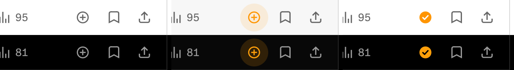

# X to Reminders

A button on every post on X that saves its link to Apple Reminders, in one click.



It sits just before Bookmark and copies the size, colour and spacing of X's own icons. Click it and the post's link (`https://x.com/<user>/status/<id>`, without tracking parameters) becomes a new reminder in your default Reminders list. The button turns into an orange tick.

- **Never twice.** Posts already in any of your lists, added from here, your phone or anywhere else, show the tick when you see them on X. Clicking one tells you which list it is in instead of adding it again.
- **Adds only.** It never edits, completes or deletes a reminder.
- **Stays on your Mac.** The extension talks to a small helper app on your Mac, which talks to Reminders. No server, no account, no network request of its own.
- Works on the timeline, on post pages, on replies and reposts (it saves the original post, never the one quoted inside it), in both versions of X's web app, in light and dark themes, in English and French.

## Install

You need a Mac, a Chromium-based browser (Chrome, Brave, Edge, Arc, Vivaldi, Helium, Chromium…) and the Command Line Tools (`xcode-select --install`).

```sh
git clone https://github.com/Soren-Starck/x-to-reminders.git
cd x-to-reminders
./install.sh
```

The script builds the helper (`X to Reminders.app`, in `~/Library/Application Support/X to Reminders/`) and registers it with every Chromium browser it finds. Then add the extension:

- from the [Chrome Web Store](https://chromewebstore.google.com/detail/fopfdggokepcffoippjlkfnmdomnlamk), or
- from this folder: open `chrome://extensions`, turn on **Developer mode**, click **Load unpacked** and choose `extension`.

Open x.com and click the new button on any post. The first time, macOS asks once whether X to Reminders may use your Reminders: click **OK**.

Click the extension's toolbar icon to check it is connected and see which list new posts go to.

## Update

```sh
git pull && ./install.sh
```

The store version updates itself through the Chrome Web Store. A copy loaded unpacked notices the new version on disk and reloads itself the next time you open X; open tabs get the new button without a reload. Running `install.sh` again is only needed when the helper (`host/`) changed, and harmless otherwise.

## Troubleshooting

| You see | Do this |
| --- | --- |
| "The Reminders helper isn't installed" | Run `./install.sh`. If your browser is not in its list, run `XTR_BROWSER_DIR="$HOME/Library/Application Support/<Browser>" ./install.sh`. |
| "Reminders access is turned off" | System Settings › Privacy & Security › Reminders: turn on **X to Reminders**. |
| No button on posts | X changed its page. Please [open an issue](https://github.com/Soren-Starck/x-to-reminders/issues/new) with the last lines of `~/Library/Logs/X to Reminders/host.log`, which record how many posts and buttons each page had. |

## How it works

[`extension/src/content.js`](extension/src/content.js) finds each post's action bar (by its role and X's own markers, which differ between X's classic and newer web apps), works out which post it belongs to and adds the button before Bookmark, measuring the icons around it so it matches them. A `MutationObserver` keeps every post covered as X adds, removes and reuses them.

A click goes through [`extension/src/background.js`](extension/src/background.js), which sends one request at a time to the helper with Chrome's [native messaging](https://developer.chrome.com/docs/extensions/develop/concepts/native-messaging). The helper, [`host/Sources/Host.swift`](host/Sources/Host.swift) (about 300 lines, no dependencies), uses EventKit: it checks every open reminder for the post's id, adds the reminder if it is not there, reads it back from Reminders' store to confirm it was saved, and answers. Opening a page on X asks the helper which posts are already in your lists; that never triggers the permission prompt, only your first click does.

## Development

```sh
sh host/build.sh              # build the helper
node test/host.test.mjs       # the helper's protocol, with a JSON file standing in for Reminders
node test/e2e.mjs             # the extension in a headless Chromium, on stand-ins for both X web apps
node test/live.mjs            # the extension on the real x.com (signed out; needs the network)
```

The tests never touch your real Reminders. `test/e2e.mjs` needs Chromium or [Chrome for Testing](https://googlechromelabs.github.io/chrome-for-testing/) (`CHROME=/path/to/binary`), since Chrome itself ignores `--load-extension`.

## Uninstall

Remove the extension from `chrome://extensions`, then run `./uninstall.sh`. Your reminders are not touched.

## License

[MIT](LICENSE). Made by [Soren Starck](https://starck.studio/?ref=github.com). X to Reminders is an independent project, not affiliated with X Corp. or Apple.
